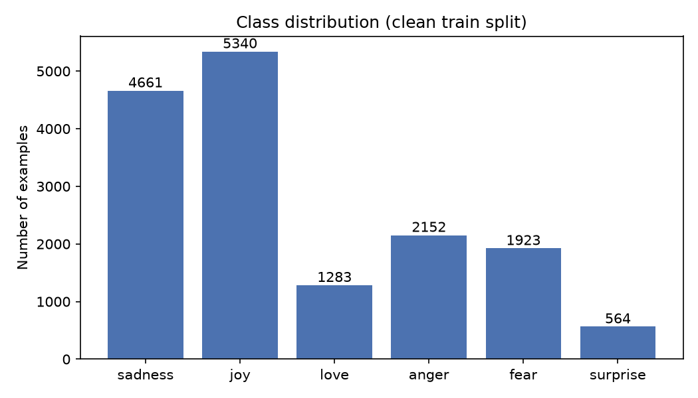
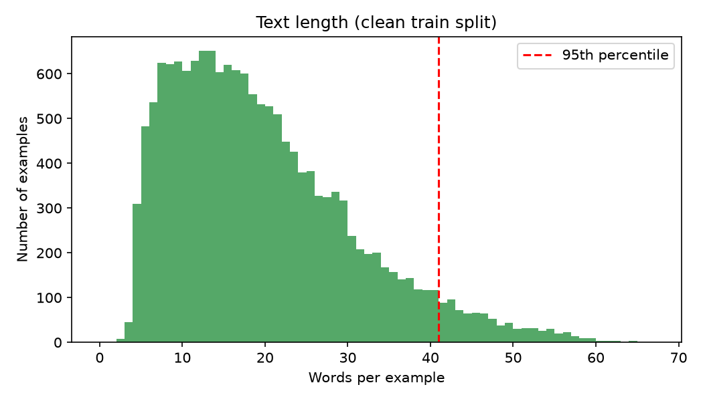
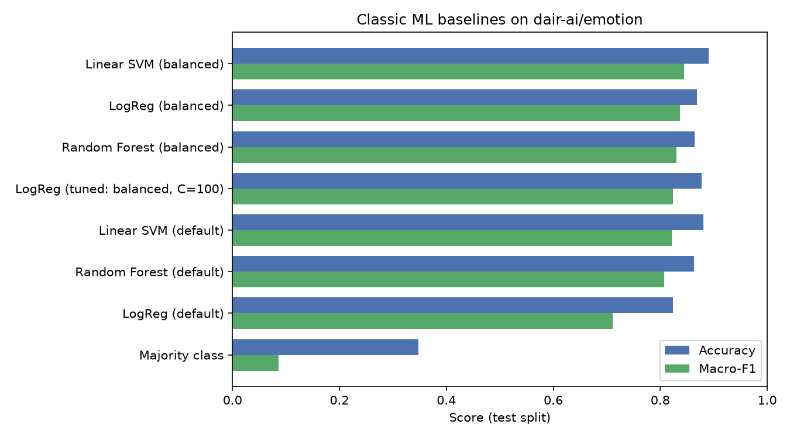
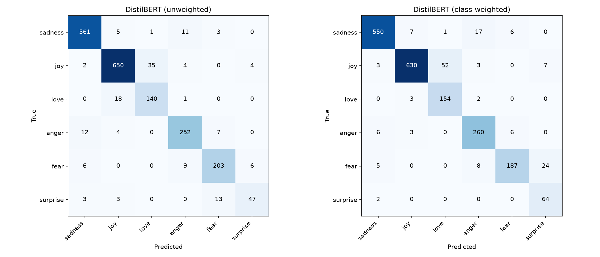
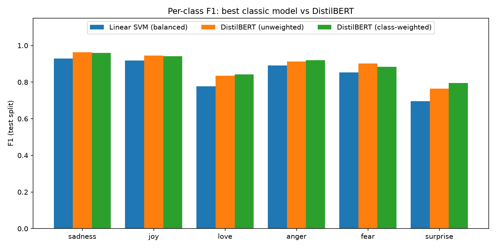

# Feedback Intelligence

An NLP system for customer feedback, built on Hugging Face. It combines a text classifier (classic ML baselines vs a fine-tuned transformer) with a retrieval-augmented question answering (RAG) service over company documents.

> Status: under active development. All reported metrics are measured by the code in this repository and saved to `results/`.

## Features

- **Feedback classifier**: TF-IDF baselines (Logistic Regression, SVM, Random Forest) compared against a fine-tuned DistilBERT.
- **Document Q&A (RAG)**: document chunking, embeddings, FAISS vector search and an LLM that answers with cited sources.
- **Serving**: FastAPI backend and a Gradio interface.
- **Deployment**: Docker image deployed to Hugging Face Spaces, with CI/CD on GitHub Actions.

## Tech stack

Python, PyTorch, Hugging Face Transformers / Datasets / Hub, scikit-learn, sentence-transformers, FAISS, FastAPI, Gradio, Docker, GitHub Actions, pytest, ruff.

## Quickstart (Windows PowerShell)

```powershell
git clone https://github.com/NORUIZ-04/feedback-intelligence.git
cd feedback-intelligence
python -m venv .venv
.venv\Scripts\Activate.ps1
pip install -r requirements.txt
pytest -q
```

## Project structure

```
configs/       YAML configuration
src/           data, classic, transformer, rag, api, utils
app/           Gradio interface
tests/         unit tests
docs/          development log and design notes
results/       saved metrics from every experiment
```

## Results

Every number below is measured by the code in this repository and saved to the results folder.

<!-- DATA_PROFILE_START -->
### Dataset: `dair-ai/emotion`

| Split | Raw rows | Clean rows |
|---|---|---|
| train | 16000 | 15923 |
| validation | 2000 | 2000 |
| test | 2000 | 2000 |

**Class distribution (clean train split)**

| Label | Count | Share |
|---|---|---|
| sadness | 4661 | 29.27% |
| joy | 5340 | 33.54% |
| love | 1283 | 8.06% |
| anger | 2152 | 13.52% |
| fear | 1923 | 12.08% |
| surprise | 564 | 3.54% |

Imbalance ratio (largest / smallest class): 9.47

**Text length in words (clean splits)**

| Split | Min | Mean | Median | P95 | Max |
|---|---|---|---|---|---|
| train | 2 | 19.18 | 17.0 | 41.0 | 66 |
| validation | 2 | 18.87 | 17.0 | 40.0 | 61 |
| test | 3 | 19.15 | 17.0 | 41.0 | 61 |

**Cleaning report**

| Check | Rows |
|---|---|
| Empty texts removed (all splits) | 0 |
| Train rows with conflicting labels removed | 60 |
| Train duplicate rows removed | 1 |
| Train rows also in validation/test removed | 16 |
| Texts shared by validation and test (kept) | 3 |




<!-- DATA_PROFILE_END -->

<!-- BASELINES_START -->
### Baseline comparison (test split)

| Model | Accuracy | Macro-F1 | Love F1 | Surprise F1 | Train s | Inference ms/example |
|---|---|---|---|---|---|---|
| Linear SVM (balanced) | 0.891 | 0.8441 | 0.7774 | 0.6957 | 0.26 | 0.0002 |
| LogReg (balanced) | 0.8685 | 0.8367 | 0.7857 | 0.7296 | 2.07 | 0.0002 |
| Random Forest (balanced) | 0.8645 | 0.8309 | 0.7692 | 0.7123 | 6.77 | 0.0292 |
| LogReg (tuned: balanced, C=100) | 0.877 | 0.8233 | 0.7414 | 0.6565 | 2.99 | n/a |
| Linear SVM (default) | 0.8805 | 0.8215 | 0.7375 | 0.6393 | 0.22 | 0.0002 |
| Random Forest (default) | 0.8635 | 0.8069 | 0.7132 | 0.6207 | 7.23 | 0.0294 |
| LogReg (default) | 0.824 | 0.7107 | 0.6008 | 0.3457 | 2.59 | 0.0002 |
| Majority class | 0.3475 | 0.086 | 0.0 | 0.0 | 0.01 | 0.0 |

All models use the same TF-IDF features (1-2 word n-grams, 50,000 features, fitted on the train split only). Rows are sorted by test macro-F1. Inference time is not recorded for the tuned LogReg run.


<!-- BASELINES_END -->

<!-- FINAL_COMPARISON_START -->
### Final model comparison (test split)

| Model | Accuracy | Macro-F1 | Love F1 | Surprise F1 | Train s | Inference ms/example | Inference setup |
|---|---|---|---|---|---|---|---|
| DistilBERT (class-weighted) | 0.9225 | 0.8903 | 0.8415 | 0.795 | 102.56 | 0.3223 | GPU, batch 64, full model |
| DistilBERT (unweighted) | 0.9265 | 0.8873 | 0.8358 | 0.7642 | 103.65 | 0.325 | GPU, batch 64, full model |
| Linear SVM (balanced) | 0.891 | 0.8441 | 0.7774 | 0.6957 | 0.26 | 0.0002 | CPU, pre-vectorized features |
| LogReg (balanced) | 0.8685 | 0.8367 | 0.7857 | 0.7296 | 2.07 | 0.0002 | CPU, pre-vectorized features |
| Random Forest (balanced) | 0.8645 | 0.8309 | 0.7692 | 0.7123 | 6.77 | 0.0292 | CPU, pre-vectorized features |
| LogReg (tuned: balanced, C=100) | 0.877 | 0.8233 | 0.7414 | 0.6565 | 2.99 | n/a | n/a |
| Linear SVM (default) | 0.8805 | 0.8215 | 0.7375 | 0.6393 | 0.22 | 0.0002 | CPU, pre-vectorized features |
| Random Forest (default) | 0.8635 | 0.8069 | 0.7132 | 0.6207 | 7.23 | 0.0294 | CPU, pre-vectorized features |
| LogReg (default) | 0.824 | 0.7107 | 0.6008 | 0.3457 | 2.59 | 0.0002 | CPU, pre-vectorized features |
| Majority class | 0.3475 | 0.086 | 0.0 | 0.0 | 0.01 | 0.0 | CPU, pre-vectorized features |

Rows are sorted by test macro-F1. Classic models train on CPU and use the same TF-IDF features; DistilBERT trains on an RTX 4050 laptop GPU with fp16. Inference times are not comparable across the two groups: classic timings exclude TF-IDF vectorizing, transformer timings are GPU forward passes.




<!-- FINAL_COMPARISON_END -->

Further tables (model comparison, retrieval metrics, RAG quality, API latency) will be added as each component is completed.

## Roadmap

- [x] Project scaffold, config, logging, metrics saver, tests, linting
- [x] Data pipeline and dataset analysis
- [x] Classic ML baselines
- [x] Transformer fine-tuning
- [x] Evaluation and error analysis
- [ ] Model release on the Hugging Face Hub
- [ ] Chunking and retrieval experiments
- [ ] Embedding comparison and FAISS index
- [ ] LLM answer generation with faithfulness evaluation
- [ ] FastAPI service
- [ ] Gradio interface
- [ ] Docker and Spaces deployment
- [ ] CI/CD pipeline
- [ ] Monitoring and performance benchmarks

## Documentation

Engineering notes are in [`docs/development-log`](docs/development-log/README.md).

## License

MIT. See [LICENSE](LICENSE).