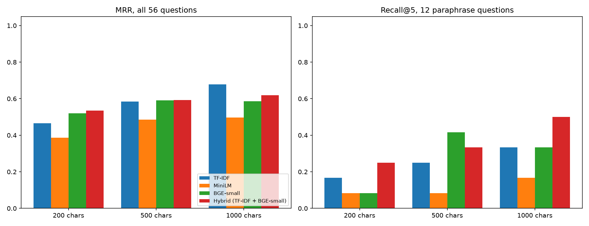

# Feedback Intelligence

An NLP system for customer feedback, built on Hugging Face. It combines a text classifier (classic ML baselines vs a fine-tuned transformer) with a retrieval-augmented question answering (RAG) service over company documents.

> Status: under active development. All reported metrics are measured by the code in this repository and saved to `results/`.

## Features

- **Feedback classifier**: TF-IDF baselines (Logistic Regression, SVM, Random Forest) compared against a fine-tuned DistilBERT.
- **Document Q&A (RAG)**: document chunking, embeddings, FAISS vector search and an LLM that answers with cited sources.
- **Serving**: FastAPI backend and a Gradio interface.
- **Deployment**: Docker image deployed to Hugging Face Spaces, with CI/CD on GitHub Actions.

## Tech stack

Python, PyTorch, Hugging Face Transformers / Datasets / Hub, scikit-learn, sentence-transformers, FAISS, FastAPI, Gradio, Docker, GitHub Actions, pytest, ruff.

## Quickstart (Windows PowerShell)

```powershell
git clone https://github.com/NORUIZ-04/feedback-intelligence.git
cd feedback-intelligence
python -m venv .venv
.venv\Scripts\Activate.ps1
pip install -r requirements.txt
pytest -q
```

## Project structure

```
configs/       YAML configuration
src/           data, classic, transformer, rag, api, utils
app/           Gradio interface
tests/         unit tests
docs/          development log and design notes
results/       saved metrics from every experiment
```

## Results

Every number below is measured by the code in this repository and saved to the results folder.

<!-- DATA_PROFILE_START -->
### Dataset: `dair-ai/emotion`

| Split | Raw rows | Clean rows |
|---|---|---|
| train | 16000 | 15923 |
| validation | 2000 | 2000 |
| test | 2000 | 2000 |

**Class distribution (clean train split)**

| Label | Count | Share |
|---|---|---|
| sadness | 4661 | 29.27% |
| joy | 5340 | 33.54% |
| love | 1283 | 8.06% |
| anger | 2152 | 13.52% |
| fear | 1923 | 12.08% |
| surprise | 564 | 3.54% |

Imbalance ratio (largest / smallest class): 9.47

**Text length in words (clean splits)**

| Split | Min | Mean | Median | P95 | Max |
|---|---|---|---|---|---|
| train | 2 | 19.18 | 17.0 | 41.0 | 66 |
| validation | 2 | 18.87 | 17.0 | 40.0 | 61 |
| test | 3 | 19.15 | 17.0 | 41.0 | 61 |

**Cleaning report**

| Check | Rows |
|---|---|
| Empty texts removed (all splits) | 0 |
| Train rows with conflicting labels removed | 60 |
| Train duplicate rows removed | 1 |
| Train rows also in validation/test removed | 16 |
| Texts shared by validation and test (kept) | 3 |


<!-- DATA_PROFILE_END -->

<!-- BASELINES_START -->
### Baseline comparison (test split)

| Model | Accuracy | Macro-F1 | Love F1 | Surprise F1 | Train s | Inference ms/example |
|---|---|---|---|---|---|---|
| Linear SVM (balanced) | 0.891 | 0.8441 | 0.7774 | 0.6957 | 0.26 | 0.0002 |
| LogReg (balanced) | 0.8685 | 0.8367 | 0.7857 | 0.7296 | 2.07 | 0.0002 |
| Random Forest (balanced) | 0.8645 | 0.8309 | 0.7692 | 0.7123 | 6.77 | 0.0292 |
| LogReg (tuned: balanced, C=100) | 0.877 | 0.8233 | 0.7414 | 0.6565 | 2.99 | n/a |
| Linear SVM (default) | 0.8805 | 0.8215 | 0.7375 | 0.6393 | 0.22 | 0.0002 |
| Random Forest (default) | 0.8635 | 0.8069 | 0.7132 | 0.6207 | 7.23 | 0.0294 |
| LogReg (default) | 0.824 | 0.7107 | 0.6008 | 0.3457 | 2.59 | 0.0002 |
| Majority class | 0.3475 | 0.086 | 0.0 | 0.0 | 0.01 | 0.0 |

All models use the same TF-IDF features (1-2 word n-grams, 50,000 features, fitted on the train split only). Rows are sorted by test macro-F1. Inference time is not recorded for the tuned LogReg run.


<!-- BASELINES_END -->

<!-- FINAL_COMPARISON_START -->
### Final model comparison (test split)

| Model | Accuracy | Macro-F1 | Love F1 | Surprise F1 | Train s | Inference ms/example | Inference setup |
|---|---|---|---|---|---|---|---|
| DistilBERT (class-weighted) | 0.9225 | 0.8903 | 0.8415 | 0.795 | 102.56 | 0.3223 | GPU, batch 64, full model |
| DistilBERT (unweighted) | 0.9265 | 0.8873 | 0.8358 | 0.7642 | 103.65 | 0.325 | GPU, batch 64, full model |
| Linear SVM (balanced) | 0.891 | 0.8441 | 0.7774 | 0.6957 | 0.26 | 0.0002 | CPU, pre-vectorized features |
| LogReg (balanced) | 0.8685 | 0.8367 | 0.7857 | 0.7296 | 2.07 | 0.0002 | CPU, pre-vectorized features |
| Random Forest (balanced) | 0.8645 | 0.8309 | 0.7692 | 0.7123 | 6.77 | 0.0292 | CPU, pre-vectorized features |
| LogReg (tuned: balanced, C=100) | 0.877 | 0.8233 | 0.7414 | 0.6565 | 2.99 | n/a | n/a |
| Linear SVM (default) | 0.8805 | 0.8215 | 0.7375 | 0.6393 | 0.22 | 0.0002 | CPU, pre-vectorized features |
| Random Forest (default) | 0.8635 | 0.8069 | 0.7132 | 0.6207 | 7.23 | 0.0294 | CPU, pre-vectorized features |
| LogReg (default) | 0.824 | 0.7107 | 0.6008 | 0.3457 | 2.59 | 0.0002 | CPU, pre-vectorized features |
| Majority class | 0.3475 | 0.086 | 0.0 | 0.0 | 0.01 | 0.0 | CPU, pre-vectorized features |

Rows are sorted by test macro-F1. Classic models train on CPU and use the same TF-IDF features; DistilBERT trains on an RTX 4050 laptop GPU with fp16. Inference times are not comparable across the two groups: classic timings exclude TF-IDF vectorizing, transformer timings are GPU forward passes.


<!-- FINAL_COMPARISON_END -->

<!-- RAG_START -->
### Retrieval comparison (56 questions: 44 original, 12 paraphrase)

| Chunk | Retriever | R@1 | R@3 | R@5 | MRR | Orig R@5 | Para R@5 | Para MRR | ms/query | Embed s |
|---|---|---|---|---|---|---|---|---|---|---|
| 200 | TF-IDF | 0.375 | 0.5357 | 0.5536 | 0.4658 | 0.6591 | 0.1667 | 0.125 | 0.03 | n/a |
| 200 | MiniLM | 0.2857 | 0.4107 | 0.5357 | 0.3865 | 0.6591 | 0.0833 | 0.0962 | 0.3 | 1.33 |
| 200 | BGE-small | 0.4286 | 0.6071 | 0.6429 | 0.5208 | 0.7955 | 0.0833 | 0.0536 | 0.72 | 1.63 |
| 200 | Hybrid (TF-IDF + BGE-small) | 0.4821 | 0.5714 | 0.6071 | 0.5341 | 0.7045 | 0.25 | 0.1833 | 0.75 | 1.63 |
| 500 | TF-IDF | 0.4643 | 0.6607 | 0.7321 | 0.5843 | 0.8636 | 0.25 | 0.213 | 0.02 | n/a |
| 500 | MiniLM | 0.4107 | 0.5179 | 0.5536 | 0.4848 | 0.6818 | 0.0833 | 0.1111 | 0.32 | 0.82 |
| 500 | BGE-small | 0.5 | 0.6607 | 0.7143 | 0.5905 | 0.7955 | 0.4167 | 0.1833 | 0.43 | 1.83 |
| 500 | Hybrid (TF-IDF + BGE-small) | 0.4821 | 0.6429 | 0.6964 | 0.5919 | 0.7955 | 0.3333 | 0.1878 | 0.45 | 1.83 |
| 1000 | TF-IDF | 0.5714 | 0.7679 | 0.8036 | 0.6787 | 0.9318 | 0.3333 | 0.2394 | 0.03 | n/a |
| 1000 | MiniLM | 0.4107 | 0.5 | 0.5714 | 0.4971 | 0.6818 | 0.1667 | 0.0865 | 0.7 | 0.45 |
| 1000 | BGE-small | 0.5 | 0.625 | 0.6964 | 0.5866 | 0.7955 | 0.3333 | 0.1925 | 0.55 | 1.86 |
| 1000 | Hybrid (TF-IDF + BGE-small) | 0.4821 | 0.6964 | 0.8214 | 0.6189 | 0.9091 | 0.5 | 0.2162 | 0.58 | 1.86 |

**Equal context budget** (Recall over all 56 questions when the retriever may return at most this many characters, so chunk sizes compare fairly):

| Retriever | Budget | 200-char chunks | 500-char chunks | 1000-char chunks |
|---|---|---|---|---|
| TF-IDF | 1000 chars | 0.5536 | 0.625 | 0.5714 |
| TF-IDF | 2500 chars | 0.625 | 0.7321 | 0.7679 |
| MiniLM | 1000 chars | 0.5357 | 0.4821 | 0.4107 |
| MiniLM | 2500 chars | 0.6607 | 0.5536 | 0.5 |
| BGE-small | 1000 chars | 0.6429 | 0.6071 | 0.5 |
| BGE-small | 2500 chars | 0.6607 | 0.7143 | 0.625 |
| Hybrid (TF-IDF + BGE-small) | 1000 chars | 0.6071 | 0.625 | 0.4821 |
| Hybrid (TF-IDF + BGE-small) | 2500 chars | 0.6607 | 0.6964 | 0.6964 |

Search is exact (NumPy dot product, or TF-IDF cosine). Hybrid is reciprocal rank fusion of TF-IDF and BGE-small. Hybrid ms/query is the sum of its two parts.



### Findings (computed from the tables, not written by hand)

- Best overall MRR: TF-IDF at 1000 characters (MRR 0.6787, Recall@5 0.8036).
- Best paraphrase MRR: TF-IDF at 1000 characters (MRR 0.2394, Recall@5 0.3333).
- Paraphrase Recall@5, TF-IDF vs the better embedding model at the same chunk size (n = 12, so one question is 0.083):
  - 200 chars: TF-IDF 0.1667, MiniLM 0.0833 (not higher)
  - 500 chars: TF-IDF 0.25, BGE-small 0.4167 (higher)
  - 1000 chars: TF-IDF 0.3333, BGE-small 0.3333 (not higher)
- Overall MRR, hybrid vs BGE-small alone:
  - 200 chars: hybrid 0.5341, BGE-small 0.5208
  - 500 chars: hybrid 0.5919, BGE-small 0.5905
  - 1000 chars: hybrid 0.6189, BGE-small 0.5866
- FAISS (IndexFlatIP, BGE-small, 500-char chunks, 567 vectors): 0.084 ms/query, top-5 identical to NumPy search for 1.0 of queries.
<!-- RAG_END -->

Further tables (model comparison, retrieval metrics, RAG quality, API latency) will be added as each component is completed.

## RAG corpus

The retrieval experiments use ten pages from the Hugging Face transformers, datasets and huggingface_hub documentation (Apache-2.0, license files in `data/docs/licenses/`), with 56 labelled questions in `data/eval/questions.yaml`. The question set was written by one author; see the development log for its limits.
## RAG answer generation

Local generation with a retrieve, rerank, generate pipeline on a 6 GB laptop GPU, evaluated on 72 answerable and 32 unanswerable questions (one author, one run).

| Metric | Qwen2.5-1.5B (fp16) | Phi-3.5-mini (4-bit) |
|---|---|---|
| Gold passage reaches the model | 58/72 | 58/72 |
| Correct (conservative keyword check, a lower bound) | 24/72 | 36/72 |
| Wrong refusals on answerable questions | 1 | 0 |
| Unanswerable questions refused | 5/32 | 18/32 |
| Seconds per answer | 0.928 | 3.86 |
| Peak GPU memory | 4.22 GB | 4.01 GB |

A 20-answer human check found the keyword scorer undercounts correct answers (it agreed with the human on 8 of 12 answerable and 7 of 8 unanswerable samples). A cross-encoder reranker raised gold-passage retrieval from 38 to 48 of 56 on the first question set. A reranker-score refusal gate was tested and rejected (threshold 5th to 95th percentile 0.029 to 0.991 across 200 splits). On-topic unanswerable questions are still mostly answered. Full numbers, limitations and failed experiments: [development log](docs/development-log/2026-10-16-rag-generation.md).
## Published model

The best fine-tuned model is on the Hugging Face Hub: [BHARATHKUMAR0409/emotion-distilbert](https://huggingface.co/BHARATHKUMAR0409/emotion-distilbert) (test accuracy 0.9265, macro-F1 0.8873).

## Licenses

The code in this repository is MIT licensed. The trained model and the data have their own terms: the dair-ai/emotion dataset states it "should be used for educational and research purposes only", and the model card says the same. The base model, distilbert-base-uncased, is Apache-2.0.
## Roadmap

- [x] Project scaffold, config, logging, metrics saver, tests, linting
- [x] Data pipeline and dataset analysis
- [x] Classic ML baselines
- [x] Transformer fine-tuning
- [x] Evaluation and error analysis
- [x] Model release on the Hugging Face Hub
- [x] Chunking and retrieval experiments
- [x] Embedding model comparison
- [ ] FAISS index in the service
- [x] LLM answer generation with faithfulness evaluation
- [ ] FastAPI service
- [ ] Gradio interface
- [ ] Docker and Spaces deployment
- [ ] CI/CD pipeline
- [ ] Monitoring and performance benchmarks

## Documentation

Engineering notes are in [`docs/development-log`](docs/development-log/README.md).

## License

MIT. See [LICENSE](LICENSE).