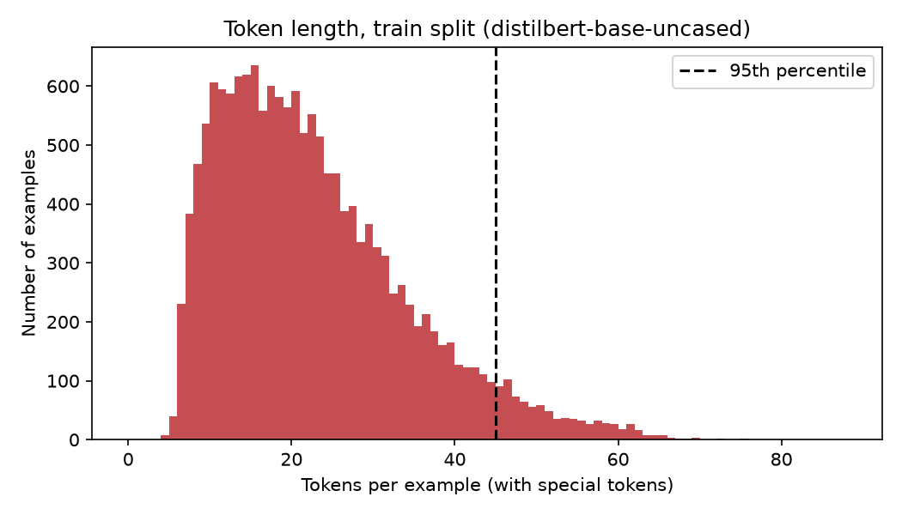

# Transformer fine-tuning (DistilBERT)

**Date:** 2026-10-12
**Status:** Done
**Branch:** `feat/transformer-finetune`

## Goal
Fine-tune DistilBERT on the same cleaned splits as the classic baselines and measure whether it beats the best classic model (balanced Linear SVM: 0.891 accuracy, 0.8441 macro-F1 on test), with and without class weighting. Then analyse where it still fails.

## Environment (measured)
| Item | Value |
|---|---|
| GPU | NVIDIA GeForce RTX 4050 Laptop GPU, 6141 MiB memory |
| NVIDIA driver / CUDA | driver 610.62, CUDA 13.3 reported by `nvidia-smi` |
| CPU | 16 logical cores, Intel64 Family 6 Model 154 |
| Python | 3.14.5 |
| torch | 2.11.0+cu128 (2771 MB wheel, installed from the PyTorch cu128 index) |
| transformers | 5.19.0 |
| accelerate | 1.15.0 (installed, not used by our code) |
| datasets / pandas / pyarrow | 5.1.0 / 3.0.6 / 26.0.0 |
| scikit-learn / matplotlib | 1.9.1 / 3.11.2 |

The Python 3.14 concern raised before installing turned out to be unfounded: a `cp314` GPU wheel of torch existed and `torch.cuda.is_available()` returned `True`.

## Design decisions
- Same splits as the classic models: train 15,923, validation 2,000, test 2,000.
- Model: `distilbert-base-uncased`, 66,958,086 parameters, 6 output classes.
- Hyperparameters (from `configs/train.yaml`, not tuned): 3 epochs, batch size 32, learning rate 2e-5, weight decay 0.01, linear schedule with 10% warmup, fp16 mixed precision, seed 42, AdamW.
- `max_length` chosen from measured token lengths (below), with per-batch dynamic padding.
- Model selection: after each epoch, evaluate on validation; keep the epoch with the best validation macro-F1; evaluate on test only once with that epoch.
- Two runs: standard cross-entropy, and cross-entropy with inverse-frequency class weights (`n_samples / (n_classes * class_count)`).
- Models are saved to `models/` (git-ignored). Metrics are saved to `results/*.json` through `save_metrics`.

## Files created
- `src/transformer/token_lengths.py`: token length statistics, truncation shares, histogram
- `src/transformer/data.py`: `TextDataset`, dynamic-padding collate function, split loader
- `src/transformer/smoke_test.py`: short end-to-end check, not a result
- `src/transformer/train.py`: full fine-tuning, `--weighted` flag
- `src/transformer/analyze.py`: final comparison, confusion matrices, error sample, reload check
- `tests/test_transformer.py`: 4 tests (dataset truncation, batch padding and mask, length stats, confusion pairs)
- `configs/train.yaml`: added `max_length`, `weight_decay`, `warmup_ratio`, `fp16`, `models_dir`
- `requirements.txt`: added `transformers==5.19.0`, comment on the CUDA build of torch

## Commands run
```powershell
pip install torch --index-url https://download.pytorch.org/whl/cu128
pip install transformers accelerate
python -m src.transformer.token_lengths
python -m src.transformer.smoke_test
python -m src.transformer.train
python -m src.transformer.train --weighted
python -m src.transformer.analyze
ruff check .
pytest -q
```

## 1. Token lengths and the max_length decision
Tokenizer `distilbert-base-uncased`, special tokens included, no truncation.

| Split | Min | Mean | Median | P95 | P99 | Max |
|---|---|---|---|---|---|---|
| train | 4 | 22.27 | 20.0 | 45.0 | 57.0 | 87 |
| validation | 4 | 21.9 | 20.0 | 44.0 | 56.0 | 69 |
| test | 5 | 22.21 | 20.0 | 45.0 | 55.0 | 66 |

Share of examples truncated at each `max_length` (%):

| max_length | train | validation | test |
|---|---|---|---|
| 32 | 17.823 | 16.9 | 18.65 |
| 48 | 3.253 | 2.95 | 3.2 |
| 64 | 0.157 | 0.1 | 0.15 |
| 96 | 0.0 | 0.0 | 0.0 |
| 128 | 0.0 | 0.0 | 0.0 |

Mean words per text were 19.18 and mean tokens 22.27, about 16% more. **Decision: `max_length = 64`.** It truncates 0.157% of train and 0.15% of test (3 test examples). `max_length = 96` would truncate nothing and was the safe alternative.



## 2. Smoke test (not a result)
2 epochs on 1,024 train examples (64 steps), evaluated on 256 validation examples.

| Check | Value |
|---|---|
| Device | cuda |
| Steps / time | 64 / 4.7s |
| Loss | first batch 1.8010, last batch 1.2591 |
| Peak GPU memory | 1.29 GB |
| Validation accuracy (256 examples) | 0.5547 |

This only confirmed that tokenizing, fp16 on the GPU, the falling loss and evaluation all work. 256 examples is about plus or minus 3 points of noise, so the accuracy is not interpreted.

## 3. Run A: standard cross-entropy
66,958,086 parameters, 1494 optimizer steps.

| Epoch | Train loss | Val accuracy | Val macro-F1 |
|---|---|---|---|
| 1 | 0.729 | 0.9285 | 0.897 |
| 2 | 0.1545 | 0.937 | 0.9075 |
| 3 | 0.1057 | 0.9425 | 0.9146 |

Best epoch by validation macro-F1: 3.

| Split | Accuracy | Macro-F1 | Weighted-F1 |
|---|---|---|---|
| validation | 0.9425 | 0.9146 | 0.9424 |
| test | 0.9265 | 0.8873 | 0.9266 |

| Class (test) | Precision | Recall | F1 | Support |
|---|---|---|---|---|
| sadness | 0.9606 | 0.9656 | 0.9631 | 581 |
| joy | 0.9559 | 0.9353 | 0.9455 | 695 |
| love | 0.7955 | 0.8805 | 0.8358 | 159 |
| anger | 0.9097 | 0.9164 | 0.913 | 275 |
| fear | 0.8982 | 0.9062 | 0.9022 | 224 |
| surprise | 0.8246 | 0.7121 | 0.7642 | 66 |

Train time 103.65s (includes per-epoch validation), peak GPU memory 1.29 GB, inference 0.325 ms/example (GPU, batch 64).

## 4. Run B: class-weighted cross-entropy
| Epoch | Train loss | Val accuracy | Val macro-F1 |
|---|---|---|---|
| 1 | 0.8363 | 0.9065 | 0.8813 |
| 2 | 0.1847 | 0.933 | 0.9102 |
| 3 | 0.129 | 0.9345 | 0.9129 |

Best epoch by validation macro-F1: 3.

| Split | Accuracy | Macro-F1 | Weighted-F1 |
|---|---|---|---|
| validation | 0.9345 | 0.9129 | 0.9358 |
| test | 0.9225 | 0.8903 | 0.9246 |

| Class (test) | Precision | Recall | F1 | Support |
|---|---|---|---|---|
| sadness | 0.9717 | 0.9466 | 0.959 | 581 |
| joy | 0.9798 | 0.9065 | 0.9417 | 695 |
| love | 0.744 | 0.9686 | 0.8415 | 159 |
| anger | 0.8966 | 0.9455 | 0.9204 | 275 |
| fear | 0.9397 | 0.8348 | 0.8842 | 224 |
| surprise | 0.6737 | 0.9697 | 0.795 | 66 |

Train time 102.56s, peak GPU memory 1.29 GB, inference 0.3223 ms/example.

## 5. Weighted vs unweighted (test)
| Run | Accuracy | Macro-F1 | Love P / R / F1 | Surprise P / R / F1 |
|---|---|---|---|---|
| Unweighted | 0.9265 | 0.8873 | 0.7955 / 0.8805 / 0.8358 | 0.8246 / 0.7121 / 0.7642 |
| Weighted | 0.9225 | 0.8903 | 0.744 / 0.9686 / 0.8415 | 0.6737 / 0.9697 / 0.795 |

- Overall scores are a tie: macro-F1 differs by 0.003 and accuracy by 0.004, with one seed each and only 66 surprise test examples.
- Weighting trades precision for recall on rare classes. It recovers 64 of 66 surprise examples, but about a third of its surprise predictions are wrong.
- It also costs the large classes some recall (joy 0.9353 to 0.9065, fear 0.9062 to 0.8348).
- Which run is preferable depends on the use case: weighted for flagging rare emotions, unweighted for trustworthy labels.

## 6. Final comparison, confusion matrices, error analysis
Generated by `src/transformer/analyze.py` from the saved results and the reloaded models.

### Final model comparison (test split)

| Model | Accuracy | Macro-F1 | Love F1 | Surprise F1 | Train s | Inference ms/example | Inference setup |
|---|---|---|---|---|---|---|---|
| DistilBERT (class-weighted) | 0.9225 | 0.8903 | 0.8415 | 0.795 | 102.56 | 0.3223 | GPU, batch 64, full model |
| DistilBERT (unweighted) | 0.9265 | 0.8873 | 0.8358 | 0.7642 | 103.65 | 0.325 | GPU, batch 64, full model |
| Linear SVM (balanced) | 0.891 | 0.8441 | 0.7774 | 0.6957 | 0.26 | 0.0002 | CPU, pre-vectorized features |
| LogReg (balanced) | 0.8685 | 0.8367 | 0.7857 | 0.7296 | 2.07 | 0.0002 | CPU, pre-vectorized features |
| Random Forest (balanced) | 0.8645 | 0.8309 | 0.7692 | 0.7123 | 6.77 | 0.0292 | CPU, pre-vectorized features |
| LogReg (tuned: balanced, C=100) | 0.877 | 0.8233 | 0.7414 | 0.6565 | 2.99 | n/a | n/a |
| Linear SVM (default) | 0.8805 | 0.8215 | 0.7375 | 0.6393 | 0.22 | 0.0002 | CPU, pre-vectorized features |
| Random Forest (default) | 0.8635 | 0.8069 | 0.7132 | 0.6207 | 7.23 | 0.0294 | CPU, pre-vectorized features |
| LogReg (default) | 0.824 | 0.7107 | 0.6008 | 0.3457 | 2.59 | 0.0002 | CPU, pre-vectorized features |
| Majority class | 0.3475 | 0.086 | 0.0 | 0.0 | 0.01 | 0.0 | CPU, pre-vectorized features |

Rows are sorted by test macro-F1. Classic models train on CPU and use the same TF-IDF features; DistilBERT trains on an RTX 4050 laptop GPU with fp16. Inference times are not comparable across the two groups: classic timings exclude TF-IDF vectorizing, transformer timings are GPU forward passes.


**Reloaded-model check:** recomputed test accuracy from the saved model files matched the saved numbers exactly: 0.9265 vs 0.9265 (unweighted) and 0.9225 vs 0.9225 (weighted).

**Confusion matrix, unweighted run** (rows true, columns predicted: sadness, joy, love, anger, fear, surprise)

| True | sadness | joy | love | anger | fear | surprise |
|---|---|---|---|---|---|---|
| sadness | 561 | 5 | 1 | 11 | 3 | 0 |
| joy | 2 | 650 | 35 | 4 | 0 | 4 |
| love | 0 | 18 | 140 | 1 | 0 | 0 |
| anger | 12 | 4 | 0 | 252 | 7 | 0 |
| fear | 6 | 0 | 0 | 9 | 203 | 6 |
| surprise | 3 | 3 | 0 | 0 | 13 | 47 |

**Confusion matrix, weighted run**

| True | sadness | joy | love | anger | fear | surprise |
|---|---|---|---|---|---|---|
| sadness | 550 | 7 | 1 | 17 | 6 | 0 |
| joy | 3 | 630 | 52 | 3 | 0 | 7 |
| love | 0 | 3 | 154 | 2 | 0 | 0 |
| anger | 6 | 3 | 0 | 260 | 6 | 0 |
| fear | 5 | 0 | 0 | 8 | 187 | 24 |
| surprise | 2 | 0 | 0 | 0 | 0 | 64 |

Top confusions (true to predicted: count):

| Unweighted (147 errors) | Weighted (155 errors) |
|---|---|
| joy to love: 35 | joy to love: 52 |
| love to joy: 18 | fear to surprise: 24 |
| surprise to fear: 13 | sadness to anger: 17 |
| anger to sadness: 12 | fear to anger: 8 |
| sadness to anger: 11 | sadness to joy: 7 |

The weighted run's extra joy to love errors (35 to 52) and the new fear to surprise confusion (24) are the counts behind its lower precision on love and surprise.

### Misclassified test examples (DistilBERT unweighted)

Total errors: 147 of 2000. The 15 below are a random sample (seed 42), not hand-picked.

| # | Text | True | Predicted |
|---|---|---|---|
| 1 | i really dont like quinn because i feel like she will just end up hurting barney and i hated the lame ted robin storyline | anger | sadness |
| 2 | i love to dance but often feel inhibited by my own body unsure what i am capable of hyper concerned about other people watching me and having opinions on my style or just feeling awkward as if i have no idea what i am supposed to do here | fear | sadness |
| 3 | i feel his hand on me to stay faithful | love | joy |
| 4 | i did not feel any passionate joy | joy | love |
| 5 | i wonder if the homeowners would feel weird if i parked to gape at their landscaping | surprise | fear |
| 6 | ive come to feel about a supporting character in one of my all time favorite films giant | joy | love |
| 7 | i have a family i can feel passionate about and completely comfortable with | joy | love |
| 8 | i seek out pain to feel tortured just to feel something | fear | anger |
| 9 | i really feel and i know the devil hates that its always been something he could use against me and im determined not to let him | joy | anger |
| 10 | i decide that picking the easy route would get me nowhere and i feel like other people want me tortured so i follow the blue path | fear | anger |
| 11 | i feel as though i have merely accepted what has been done and that no matter what time has gone by it will always be with me | joy | love |
| 12 | i feel so helpless right now | fear | sadness |
| 13 | i feel like some of you have pains and you cannot imagine becoming passionate about the group or the idea that is causing pain | joy | love |
| 14 | ive got a off sale the ad says starting tomorrow but im feeling generous and started it now | love | joy |
| 15 | i never dreamed i would be so busy so soon in the new year but i am loving it and feeling so very gracious and fortunate | joy | love |

Reading the sample (15 random errors out of 147, so only indicative):
- 6 of 15 are true joy predicted as love, often with words such as "passionate" or "loving" in the text.
- Several look ambiguous or arguably mislabeled rather than clear model failures, for example a negated phrase ("did not feel any passionate joy") labeled joy, and "i feel so helpless right now" labeled fear and predicted sadness.
- A likely explanation is label noise from how the dataset was labeled (I believe it used automatic keyword-based labeling, which was not verified here). If so, part of the remaining error may not be fixable by a bigger model. This sample is too small to quantify it.

## Key findings
- DistilBERT beats the best classic baseline on every metric without any tuning: test accuracy 0.9265 vs 0.891 (+0.0355) and macro-F1 0.8873 to 0.8903 vs 0.8441 (+0.043 to +0.046).
- DistilBERT is better on every class, and the gain is largest on the rare classes (surprise F1 0.6957 to 0.7642 or 0.795, love 0.7774 to 0.8358 or 0.8415).
- Class weighting changes the error pattern much more than the headline score.
- Surprise and love are still the weakest classes, and joy to love is the largest single confusion.
- Cost: about 103s to train on a laptop GPU, against 0.26s for the SVM on CPU. Inference is 0.32 ms/example on GPU versus 0.0002 ms for the SVM on pre-vectorized features (not directly comparable, see below).

## Where my expectations were right or wrong
| Expectation | What happened |
|---|---|
| PyTorch GPU wheel might not exist for Python 3.14 | It existed; CUDA available on the first try |
| Smoke test peak memory 1 to 2 GB, under a minute | 1.29 GB, 4.7s |
| Full run takes about 2 to 3 minutes | 103.65s (about 1.7 minutes), a little faster than estimated |
| Test accuracy around 0.92, above the SVM | 0.9265, correct |
| Best epoch 2 or 3 | Epoch 3 in both runs; validation macro-F1 was still rising |
| Weighted run would change macro-F1 by a point or two | Changed by only 0.003 |
| Biggest confusions among overlapping emotions such as joy and love, fear and surprise | joy and love confirmed; fear and surprise appeared, but surprise to fear (13) in the unweighted run and fear to surprise (24) in the weighted run |
| Reloaded models reproduce saved accuracy | Exact match for both |

## Limitations
- One seed (42) per configuration. Differences of about 0.01 macro-F1, including weighted vs unweighted, are within noise. Several seeds would be needed to rank them.
- Only 3 epochs, and validation macro-F1 was still rising at epoch 3, so the model may be slightly under-trained.
- No hyperparameter search for DistilBERT (learning rate, batch size and epochs are defaults), while Logistic Regression had a C sweep. The classic-vs-transformer gap is therefore not an upper bound for either side.
- The test set has 66 surprise and 159 love examples, so per-class scores for them are noisy.
- Inference timings are not comparable across groups: classic timings are CPU, on pre-vectorized features, excluding TF-IDF; transformer timings are GPU forward passes with batch size 64.
- `max_length = 64` truncates 3 test examples.
- Label noise likely limits the achievable score, but this was not measured.
- The error sample is 15 of 147 random errors; patterns in it are indicative, not proven.

## Problems faced and fixes
| Problem | Cause | Fix |
|---|---|---|
| ruff PIE808 in `token_lengths.py` | Redundant `0` start in `range` | Auto-fixed with `ruff check . --fix` |
| ruff ISC004 in `analyze.py` | Summary sentence split over two string literals inside a list | Moved it into a parenthesized `summary` variable |
| Uncertainty about GPU torch on Python 3.14 | Very new Python version | Tried the cu128 index first; wheel existed |
| Cannot compare inference speed directly | CPU/pre-vectorized vs GPU/full model | Added an "Inference setup" column and a note to the comparison table |

## Verification (real terminal output)
```
> ruff check .
All checks passed!

> pytest -q
..............                                                           [100%]
14 passed in 6.78s
```

## Reproducing this result
```powershell
pip install -r requirements.txt
pip install torch --index-url https://download.pytorch.org/whl/cu128
python -m src.data.prepare
python -m src.transformer.token_lengths
python -m src.transformer.train
python -m src.transformer.train --weighted
python -m src.transformer.analyze
```
GPU training is not bit-for-bit deterministic, so expect small differences even with the same seed.

## Next
Package the best model for the Hugging Face Hub with a model card, then load it back through a `pipeline` to confirm it works.